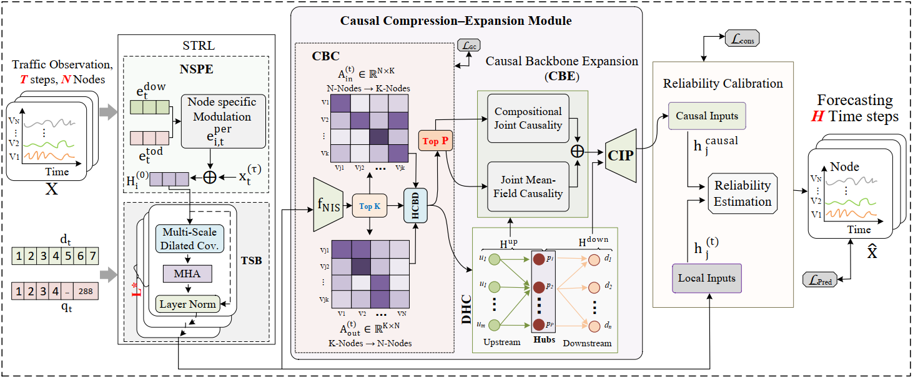

# SCauCE: A Scalable Causal Compression–Expansion Framework for Traffic Forecasting

This is a PyTorch implementation of the paper: **"A Scalable Causal Compression–Expansion Framework for Traffic Forecasting"**.

<p align="center">
  
</p>

---

## ⚡ Requirements

- matplotlib
- numpy
- scipy
- pandas
- torch

Install them with:

```bash
pip install matplotlib numpy scipy pandas torch
```

---

## 📂 Folder Structure

```text
SCauCE/
├── conf/                         # Dataset/model configurations
│   ├── PEMSD3_1dim_12.conf
│   ├── PEMSD4_1dim_12.conf
│   ├── PEMSD7_1dim_12.conf
│   └── PEMSD8_1dim_12.conf
├── data/                         # Place prepared/raw datasets here
│   ├── PEMS03/
│   ├── PEMS04/
│   ├── PEMS07/
│   └── PEMS08/
├── data_utils.py                 # Data utilities
├── Engine.py                     # Training engine
├── Losses.py                     # Loss functions and metrics
├── Model.py                      # SCauCE main model
├── prepareData.py                # Data preprocessing
├── Train.py                      # Main training and testing script
├── Readme.md
└── Requirement.txt     
```

---

## 🔧 Data Preparation

Datasets used: **PEMS08, PEMS07, PEMS04, PEMS03**

Download the data from [Google Drive](https://drive.google.com/drive/folders/1SZbGhd8epBjzOC1AIff5cx3f39hcDwyP?usp=drive_link) and unzip them into the corresponding folders under `data/`.

> **Tip:** The name of each downloaded dataset folder must match the name used in the configuration files.

---

## 🚀 Run

### 1. Data preprocessing

```bash
python prepareData.py
```

### 2. Train the model

```bash
python Train.py --config conf/PEMSD8_1dim_12.conf
python Train.py --config conf/PEMSD7_1dim_12.conf
python Train.py --config conf/PEMSD4_1dim_12.conf
python Train.py --config conf/PEMSD3_1dim_12.conf
```

---

## Citation

If you find this paper and code helpful in your research, please cite the SCauCE paper.

> **Note:** The BibTeX entry will be updated once the paper is officially published.

```bibtex
% To be updated upon publication.
